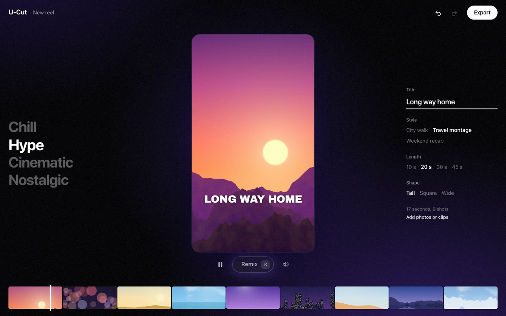
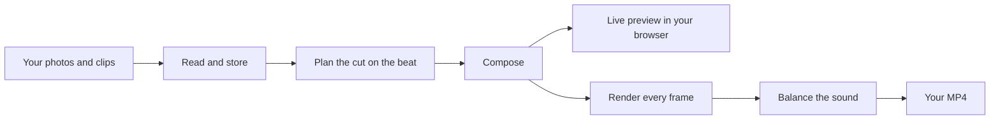

# U-Cut

**Drop in your photos and clips. Get a finished reel, cut to music, in seconds. Free, open source, and it all runs on your own computer.**



## Get started

You need a Mac with Apple Silicon. Paste this into Terminal:

```bash
curl -fsSL https://raw.githubusercontent.com/mayank29deo/U-Cut/main/install.sh | bash
```

The installer sets everything up, and uses Homebrew to add FFmpeg and Node if they're missing. Then open **U-Cut** from your Applications folder, or type `ucut`.

No files to hand? Press **Try it with sample photos**.

## What it does today

| You want to                                                                        | Status                                                                                                                                                                                        |
| ---------------------------------------------------------------------------------- | --------------------------------------------------------------------------------------------------------------------------------------------------------------------------------------------- |
| Turn photos and clips into a reel cut to music                                     | **Works today**                                                                                                                                                                               |
| Remix, switch vibe, change the shape, edit the title, swap a shot, undo anything   | **Works today**                                                                                                                                                                               |
| Export an MP4 balanced for phones                                                  | **Works today**                                                                                                                                                                               |
| Use it as a Mac app, in a browser, or from the command line                        | **Works today**                                                                                                                                                                               |
| Share one computer between up to 20 people on your network                         | **Works today**                                                                                                                                                                               |
| Use your own music                                                                 | Command line only for now                                                                                                                                                                     |
| Sort photos into scenes, skip screenshots and near-copies, and pick the best shots | **Works today** on a Mac. It's right about two times in three on photos from new places, and a wrong one takes a click to fix                                                                 |
| Copy the style of a reel you admire                                                | **Works today.** It learns the rhythm, text style and colour, and never uses that reel's footage, sound or words. Tested on generated reels so far                                            |
| Turn a screen recording into a product demo                                        | **Works today.** It finds the moments, pushes in on the action, and adds captions and title cards. Captions are in English for now                                                            |
| Write a reel from a sentence                                                       | **Works today.** It writes a short script, reads it in a local voice, and builds the reel from your photos or from words and colour. Connect Claude for better scripts, or use your own words |
| Make reels from your assistant: Claude Code, Claude Desktop, Cursor and others     | **Works today**, through `ucut mcp` and the Claude Code plugin. An assistant can also change the reel you have open                                                                           |
| Use your own services for writing, voices and listening                            | **Works today with Deepgram,** tested live for reading aloud and listening. Claude, ElevenLabs, OpenAI and Voice Studio are built but not yet tried live. Each is off until you choose it     |

The [plan](docs/PLAN.md) has the full roadmap.

## How to use it

Everything is the same reel engine underneath, so pick whichever way suits you.

**As a Mac app.** Open U-Cut from Applications.

**In your browser, on any computer.** Run `ucut`. It opens at <http://localhost:4173>.

**From the command line.**

```bash
ucut make ~/Pictures/Goa --vibe hype --title "Goa, day one" -o goa.mp4
ucut sort ~/Pictures/Goa
ucut study a-reel-i-love.mp4
ucut make ~/Pictures/Goa --like a-reel-i-love.mp4 -o goa.mp4
ucut demo recording.mov --name "Acme" --colour "#7b5cff" -o demo.mp4
ucut write "a 20-second reel about my Goa trip, chill vibe" ~/Pictures/Goa -o goa.mp4
```

Run `ucut make --help` for every option.

**With Docker, on Linux or anywhere else.**

```bash
docker build -t u-cut https://github.com/mayank29deo/U-Cut.git
docker run --rm -p 127.0.0.1:4173:4173 -v u-cut-data:/data u-cut
```

**With your assistant.** In Claude Code:

```
/plugin marketplace add mayank29deo/U-Cut
/plugin install u-cut@u-cut
```

Claude Desktop, Cursor and other assistants can use `ucut mcp` too. [Connecting your assistant and services](docs/CONNECT.md) covers every setup, including bringing your own ElevenLabs, Deepgram or Voice Studio voices.

**With other people on your network.**

```bash
ucut serve --lan
```

This prints a private link to share. Everyone edits instantly on their own screen, and exports take turns fairly. [Here's how that works](docs/ARCHITECTURE.md).

Stuck? [The install guide](docs/INSTALL.md) covers updating, uninstalling and common problems. `ucut doctor` checks your setup.

## Good to know

- **Your files stay with you.** Nothing leaves your computer unless you choose a service, and U-Cut says what goes. A test blocks the network and makes every kind of reel to prove it.
- **It's free.** There are no accounts and no per-render fees. Claude is optional: use it through your own Claude Code with the plugin, or with your own API key.
- **Services are yours to choose.** Connect ElevenLabs, Deepgram, OpenAI or Voice Studio if you like. Nothing is sent until you choose a service, and the app says what goes to it.
- **It's fast on ordinary Macs.** On an 8 GB MacBook, a 27-second reel took 27 seconds to export.
- **Reels are yours.** The bundled music and sample photos are CC0, so you can post your reels anywhere.

## How it works



The plan is a small JSON file. The same plan produces the preview and the final video, so what you see is what you export. Remixing is just making a new plan, which takes a few milliseconds in your browser.

[The architecture guide](docs/ARCHITECTURE.md) explains the whole system. [The design guide](docs/DESIGN.md) explains how the interface is made.

## Find your way around

| Folder                                             | What's inside                                                             |
| -------------------------------------------------- | ------------------------------------------------------------------------- |
| [`apps/web`](apps/web)                             | The interface, built with React. The Mac app and browsers both show this. |
| [`apps/site`](apps/site)                           | The website. It plays a real reel in the page, with no server.            |
| [`apps/mac`](apps/mac)                             | The native Mac app that hosts the interface.                              |
| [`packages/engine`](packages/engine)               | The `ucut` command, the media pipeline and the server.                    |
| [`packages/planner-rules`](packages/planner-rules) | Decides what goes where. Runs in the browser.                             |
| [`packages/planner-api`](packages/planner-api)     | Writes scripts with Claude, using your own API key.                       |
| [`plugin`](plugin)                                 | The Claude Code plugin: U-Cut's MCP server, a skill and commands.         |
| [`packages/compose`](packages/compose)             | Turns a plan into the composition that gets previewed and rendered.       |
| [`packages/schema`](packages/schema)               | The shape of every data file, for TypeScript and Swift.                   |
| [`templates`](templates)                           | Styles of reel. [Adding one](templates/README.md) takes five minutes.     |
| [`library`](library)                               | Music, fonts and sample photos, each with its licence.                    |
| [`docs/decisions`](docs/decisions)                 | Why things are the way they are.                                          |

## Build it yourself

```bash
git clone https://github.com/mayank29deo/U-Cut.git
cd U-Cut
corepack enable
pnpm install
pnpm build
node packages/engine/dist/bin.js setup
pnpm start
```

| Command             | What it does                                             |
| ------------------- | -------------------------------------------------------- |
| `pnpm check`        | Lint, types, unit tests and the licence scan             |
| `pnpm test:int`     | Real reels with real FFmpeg and Chrome                   |
| `pnpm test:e2e`     | Clicks through the whole app in a real browser           |
| `pnpm test:privacy` | Makes a reel with the network blocked                    |
| `pnpm load-test`    | Simulates 20 people at once and reports what they'd feel |

## Contribute

Better music is the easiest way to help: our starter tracks are synthesised to prove the pipeline. New templates are next. See [CONTRIBUTING.md](CONTRIBUTING.md).

## Licence

Code is [Apache-2.0](LICENSE). Each bundled asset lists its own licence in the `assets.json` beside it.
