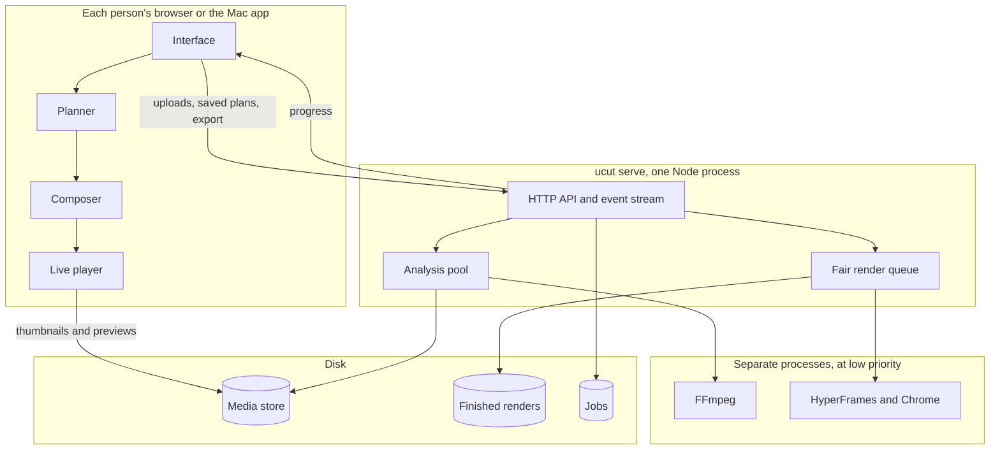

# How U-Cut works

This guide is for engineers who want to understand or change the system. It explains the design, why it stays fast with 20 people sharing one computer, and where its limits are.

## The idea that shapes everything

Rendering a video is expensive. Deciding what the video should be is cheap.

A reel is a small JSON file called an **EditPlan**, which says which media appears when, with what motion and text. Planning takes under a millisecond. Turning that plan into 900 frames of video takes a minute. So U-Cut splits the work by how fast it has to feel, and puts each kind where it costs the least.

| Work                                                 | Must feel         | Where it runs                  | Cost to the server         |
| ---------------------------------------------------- | ----------------- | ------------------------------ | -------------------------- |
| Remix, change vibe, edit title, swap a shot, preview | Instant           | **In the person's browser**    | None                       |
| Reading a new photo or clip                          | A second or two   | Analysis pool, shared and fair | Once per file, ever        |
| Exporting the final MP4                              | Worth waiting for | Render queue, bounded and fair | Once per unique plan, ever |

Because the browser runs the planner and the preview, a Remix never touches the server. That's why it takes milliseconds, and why more people doesn't make editing slower for anyone.

## The pieces

- **Planner** ([`packages/planner-rules`](../packages/planner-rules)) is a pure function with no Node dependencies. The same input always gives the same plan, byte for byte.
- **Composer** ([`packages/compose`](../packages/compose)) turns a plan into HTML and CSS keyframes. It's also pure.
- **Live player** ([`apps/web/src/stage/player.ts`](../apps/web/src/stage/player.ts)) plays that composition in a Shadow DOM, setting every clip and animation from a single clock.
- **Engine** ([`packages/engine`](../packages/engine)) reads media, renders with [HyperFrames](https://github.com/heygen-com/hyperframes), and masters the sound with FFmpeg.

The preview and the export use the same composer output, so they match. Only the media differs: the preview uses small copies and the export uses originals.

## What happens when you drop a file

1. The browser streams the file to `PUT /api/jobs/:id/media/:name`.
2. The server hashes it as it arrives and stores it once, named by its content. An identical file from anyone is stored once.
3. It reads the metadata straight away and replies.
4. A small copy goes into the analysis pool: a thumbnail, plus a display image or a 540p preview video. These are cached forever, because content never changes under a hash.
5. An event tells the browser when it's ready.
6. Once everything has arrived, the browser plans the reel and it starts playing, with no button to press.

## How sorting works

Apple's Vision framework looks at each photo in a small helper, `ucut-vision`, which stays open while there's work to do, because loading its models is the slow part. It gives a feature print, labels, faces, an aesthetics score and where the subject is. Clips are sampled at up to five frames, and the scene they show most wins.

[`packages/classify`](../packages/classify) turns those signals into scenes, finds near-copies and groups moments. These results are stored with the file, so each photo is read once. Without the helper, such as on Linux, everything else still works and the sort view shows moments only.

The planner then uses the results: it leaves out hidden scenes, keeps only the best of a run of near-copies, favours better photos, opens on the best shot, and keeps each photo's subject in frame.

A correction made in the sort view is saved on your computer, so nearly identical photos sort themselves next time. [ADR 0016](decisions/0016-scenes-from-apple-vision.md) has the accuracy figures.

## How matching a reel works

`ucut study` measures a reel's cuts, beats, colour and text layout, and writes a small `StyleRecipe`. The reel goes to a temporary folder and is deleted straight after, so it never enters the media store. Text recognition returns positions only, so the reel's words never reach U-Cut at all.

The recipe then drives the same planner as everything else, in the browser: shot lengths per section become whole beats of a licensed track chosen by tempo. [ADR 0017](decisions/0017-reference-reels-keep-structure-only.md) explains the rules and how they're tested.

## How a screen recording becomes a demo

The server listens to the recording with whisper.cpp and watches it with `hyperframes measure events`, one recording at a time because listening uses every core. It stores the timed words and screen changes with the file, along with a 1600-pixel copy that has sound.

Then the browser takes over. `findMoments` suggests one moment per sentence, or one per burst of screen change if nobody speaks. `planDemo` turns the moments you keep into a plan, so skipping a moment or changing the colour is instant. The composer shows the recording whole, holds each push-in while the action plays, and draws the cards. [ADR 0018](decisions/0018-demos-from-speech-and-screen-changes.md) has the reasoning.

## How a sentence becomes a reel

The browser does nearly all of this. `readPrompt` reads the sentence, `writeScript` writes the lines from fixed patterns, and `planScript` builds the reel, all before a server is involved. The reel appears straight away with estimated timing.

Then each line goes to the server to be read aloud, one call at a time through a fair queue, and is cached by its words, voice and speed. As the real lengths come back, the plan is rebuilt around them. [ADR 0019](decisions/0019-written-reels-rules-first.md) has the reasoning.

## What happens when you export

1. The browser saves the plan and calls `POST /api/jobs/:id/export`.
2. The server hashes the plan, template and quality into a render key.
3. If that render exists, it returns at once. If the same render is already queued or running, the request joins it.
4. Otherwise it enters the fair queue. Each person sees their place in line and an estimate, which learns from this machine's real render times.
5. In a slot, the engine writes the project, calls HyperFrames with `--sdr --no-best-effort`, masters the loudness in two passes, then checks the file against the output spec.
6. An event delivers the finished reel.

## Why 20 people stay fast

Four decisions do most of the work.

**Nothing heavy runs in the server process.** The Node process only moves bytes and keeps state. FFmpeg and Chrome are child processes at low priority (`nice 10`), so the operating system always favours the interface over a render.

**Work is bounded.** Starting 20 renders at once on 8 GB would push the machine into swap and make everyone slower. [`Scheduler`](../packages/engine/src/server/scheduler.ts) runs only what fits and queues the rest.

**The queue is fair.** Plain first-come-first-served would let someone exporting ten reels block everyone behind them. U-Cut uses start-time fair queuing: whoever has been served least goes next. A newcomer joins one turn behind the others, so they neither wait out a backlog nor take over.

**Everything is cached by content.** There are three layers:

| Layer        | Key                               | Saves                                                            |
| ------------ | --------------------------------- | ---------------------------------------------------------------- |
| Browser      | Hash in the URL, marked immutable | Re-downloading thumbnails and previews                           |
| Media store  | Hash of the file                  | Re-reading a file anyone has already added                       |
| Render store | Hash of the plan                  | Re-rendering an identical reel. Measured at 3 ms instead of 40 s |

The event stream is thinned to five updates a second per render, so a slow connection can't back up the server.

## How much it can carry

We measured this rather than guessing. One 6-core, 8 GB Mac, already using 14 GB of swap from other apps, exporting six 4-second reels:

| Parallel renders | Chrome workers each | Finished | Reel seconds per second |
| ---------------- | ------------------- | -------- | ----------------------- |
| 1                | 3                   | 29.8 s   | 0.80                    |
| 2                | 1                   | 24.9 s   | 0.97                    |
| 3                | 1                   | 21.7 s   | 1.11                    |

More parallel renders beat more workers per render, because Chrome's frame capture scales poorly with workers. But one person alone shouldn't get a single worker, so capacity adapts ([`capacity.ts`](../packages/engine/src/server/capacity.ts)):

- **Slots:** half the CPU cores, limited by memory at about 450 MB each. Set `UCUT_RENDER_SLOTS` to override it.
- **Workers:** one person gets all of them for the fastest export. When a queue forms, they're shared across slots for the most total throughput.

## What 20 people get

From `pnpm load-test --users 20 --seconds 4`, on that same Mac. Each simulated person uploads five photos, plans a reel, keeps using the interface while their export waits, then exports again.

| Measure                                            | Median     | 95th percentile | Worst  |
| -------------------------------------------------- | ---------- | --------------- | ------ |
| Planning a new cut                                 | under 1 ms | 11 ms           | 11 ms  |
| Uploading one photo                                | 138 ms     | 245 ms          | 375 ms |
| Interface requests during exports (9,692 requests) | 1 ms       | 13 ms           | 137 ms |
| Export, including time in line                     | 42 s       | 69 s            | 69 s   |
| Exporting the same reel again                      | 3 ms       | 13 ms           | 13 ms  |

All 20 finished with no failures, in 69.9 seconds.

Read those numbers carefully, because two things are true at once:

- **Editing is unaffected by load.** Everyone keeps instant Remix and preview, because none of that touches the server.
- **Exports do wait.** A shared machine has a fixed amount of rendering power. Twenty 4-second draft reels at once meant a median wait of 42 seconds. Twenty 30-second reels would take about 8 minutes for the last person on this Mac. The queue keeps that wait fair and visible, but it can't remove it.

A larger machine helps directly, since slots scale with cores and memory. A 16-core Mac with enough memory gets 8 slots. These figures come from generated images: real footage is slower. On this Mac, a 19-second reel from 4K HEVC clips took 42 seconds to export alone.

The usual case is simpler. Twenty people with twenty Macs share nothing, so each gets the solo experience: a 27-second reel exported in 27 seconds.

## Security when shared

A local web server is a real attack surface, so U-Cut assumes other software and other people are hostile.

| Threat                                                  | Defence                                                                              |
| ------------------------------------------------------- | ------------------------------------------------------------------------------------ |
| A website you visit calling `localhost` (DNS rebinding) | Every request's `Host` header must be on a short list                                |
| A website posting to the server (CSRF)                  | `Origin` must match on writes, and cookies are `SameSite=Strict`                     |
| Strangers on your network                               | It binds to `127.0.0.1` by default. `--lan` is opt-in and needs a random access code |
| One person reading another's reel                       | Jobs and renders are checked against the session that made them                      |
| Guessing someone's media                                | Media URLs use 128 bits of content hash, which works as a capability                 |
| Path traversal through file names or URLs               | Names are sanitised, and static paths must resolve inside the web folder             |
| Filling the disk                                        | New work is refused below 1.5 GB free, with a plain message                          |

The tests in [`app.test.ts`](../packages/engine/src/server/app.test.ts) cover these. `--lan` is designed for a trusted home or office network. It has no TLS, so don't expose it to the internet.

## When things fail

- A failed render frees its slot and tells that person why. Nobody else is affected.
- A bad file is skipped with a reason. It never stops a reel.
- Exports finish with the screen asleep, and on a Mac U-Cut holds off system sleep while it renders.
- Cancelling kills the child processes and frees the slot.
- Renders are checked against the output spec before being offered.
- Plans autosave, so a reload brings your reel back.
- In the Mac app, the engine watches a pipe from the app, so even a force-quit can't leave it running.

## Offline by design

The default path makes no network calls, and [`scripts/privacy-test.sh`](../scripts/privacy-test.sh) proves it by rendering inside a macOS sandbox that denies outbound traffic. HyperFrames has telemetry and online features, so all calls go through [`hf.ts`](../packages/engine/src/hf.ts), which turns telemetry and update checks off and refuses commands that upload. See [ADR 0001](decisions/0001-hyperframes-pinned-and-offline.md).

## Known limits

- **The queue lives in memory.** Restarting the server drops queued exports. Plans survive, so people can export again.
- **One machine only.** The next step for more capacity is `ucut worker`, which would let other computers take renders from the queue.
- **Whole-reel renders.** Changing one word re-renders everything. Rendering shot by shot and caching segments would make re-exports much faster.
- **Upload size.** Files are capped at 8 GB, and a very large pile takes a while to read before the reel appears.

Larger decisions are recorded in [docs/decisions](decisions/).
