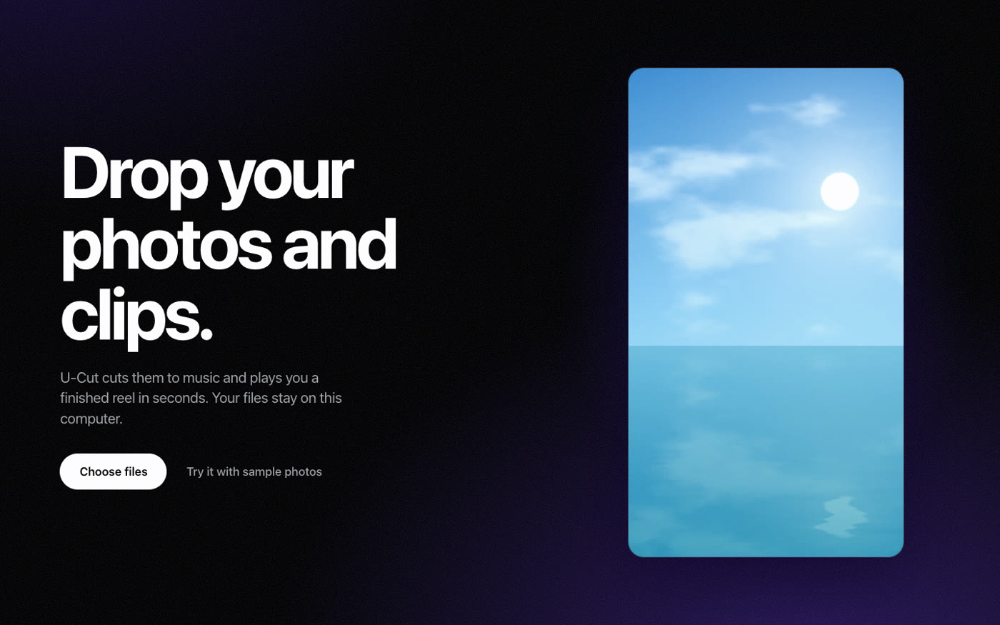

# How U-Cut's interface is designed

This guide is for anyone changing the interface. It records what we're making, the rules we follow, and why.



## The concept: a darkroom

U-Cut is a darkroom. The room is true black, the only lit thing is your reel, and a faint violet safelight glows behind it. The safelight breathes in time with your music, so the room feels alive without anything competing with the reel.

Everything follows from that:

- **Black and white do the work.** Black is `#000`, not a tinted grey. Text is pure white or a lower-contrast grey.
- **Purple is atmosphere only.** It appears as a light leak, film grain and the glow behind the reel. No button, label or control is ever purple. The one exception is the focus ring, which needs to stand out.
- **Words are the controls.** Vibes are a stack of large words. The chosen one lights up. There are no cards or boxes, because a darkroom doesn't have a dashboard.
- **One white button.** Export is the only solid white control while editing, so you always know how to finish. New reel sits beside it as an outlined pill: starting and finishing live in the same place.

## The splash

The app opens on the logo: **U ✂ Cut** in bold white on purplish black, with the scissors standing in for the hyphen. The scissors snip twice as "Cut" is cut open beside them, then the screen fades into the app.

It lasts under two seconds, and any click or key skips it. It plays once a session, and the Mac app draws the same mark natively, so nothing sits on an empty window while the engine starts.

The scissors are drawn by hand in two halves that pivot, in [`icons.tsx`](../apps/web/src/components/icons.tsx) and [`Splash.swift`](../apps/mac/Sources/UCut/Splash.swift). Keep the two in step.

## The product rule: the reel comes first

Most video tools ask you to choose settings, then wait, then see a result. U-Cut does it backwards.

1. You drop your files.
2. Your reel starts playing, with no button to press.
3. Everything after that is reacting to something you can already see.

The first screen follows the same rule by playing a real reel instead of describing one.

## What keeps people watching

We want people to stay because making reels feels great. That comes from four things:

| Principle                | How it shows up                                                                                                       |
| ------------------------ | --------------------------------------------------------------------------------------------------------------------- |
| **No waiting**           | Remix takes about 10 ms. Changing vibe re-cuts at once.                                                               |
| **Variety with no risk** | Every press of `R` gives a new cut, and a shutter blink marks the moment. Full undo means no press can ruin anything. |
| **Always moving**        | Reels loop like they do on a phone, and the room pulses on the beat.                                                  |
| **Your own memories**    | The best content in the app is the person's own photos.                                                               |

We don't use streaks, badges, notifications, countdowns or guilt. Those work by making people feel worse when they leave, and a tool that respects someone is one they come back to. If a change gets people to stay longer without making the reel better, we don't ship it.

## Tokens

These live at the top of [`app.css`](../apps/web/src/styles/app.css).

| Token         | Value        | Use                                         |
| ------------- | ------------ | ------------------------------------------- |
| `--black`     | `#000`       | The room                                    |
| `--white`     | `#fff`       | Text and the one solid button               |
| `--ash`       | `#a1a1a6`    | Secondary text                              |
| `--smoke`     | white at 14% | Hairlines                                   |
| `--haze`      | white at 6%  | Hover fills                                 |
| `--safelight` | `#7b5cff`    | The glow behind the reel and the focus ring |

**Type.** One family: the system font, which is SF Pro on a Mac, falling back to Inter. Headlines use weight 700 with tight tracking, around −0.04 em. Interface text is 13 to 15 px.

**Shape.** The reel has a 22 px radius, like a phone. Actions are pills. Shot tiles are 5 px, because they're pieces of film rather than controls.

**Motion.** Two curves: `--spring` for things you press, and `--ease` for things that arrive. Motion answers an action. The only movement that isn't triggered by someone is the reel and the beat pulse.

## Layout

```
┌───────────────────────────────────────────────────────┐
│ U-Cut              Undo Redo  + New reel  Export      │
│                                                       │
│                     ┌─────────┐                       │
│ Chill               │         │          Title        │
│ Hype                │  your   │          Style        │
│ Cinematic           │  reel   │          Length       │
│ Nostalgic           │         │          Shape        │
│                     └─────────┘                       │
│                      ▮▮  Remix  R  ♪                  │
│ ▮▮▮▮▮▮▮|▮▮▮▮▮▮▮▮▮▮▮▮▮▮▮▮▮▮▮▮▮▮▮▮▮▮▮▮▮▮▮▮▮▮▮▮▮▮▮▮▮▮▮▮▮ │
└───────────────────────────────────────────────────────┘
```

Left is how it feels. Right is how it's built. The bottom is what's in it. The top right is how you start and finish. On a phone these stack: reel, vibes, shots, settings.

The strip along the bottom shows each shot at its real length, so the rhythm of the cut is visible at a glance.

## The sort view

The sort view is a contact sheet, the sheet of small prints a photographer marks up in a darkroom. Scenes run down the left as big words, using the same language as the vibes, and every photo sits to the right.

- Pressing a scene leaves it out of the reel, and the word is struck through so you can see why.
- Dragging a photo onto a scene fixes it. Pressing a photo opens the same choice as a menu, so it also works by keyboard and on a phone.
- Nothing is ever deleted. Screenshots start out left out, and one press brings them back.

## Matching a reel

"Match a reel you love" sits under the vibes, because it's another way of choosing how a reel feels. Once studied, **Your reel** appears as a fifth big word, and a card says in plain English what U-Cut learned, with a promise that nothing from that reel appears in yours. Choosing any vibe or style goes straight back, and undo works as usual.

## Keyboard

| Key         | Action                |
| ----------- | --------------------- |
| `Space`     | Play or pause         |
| `R`         | Remix                 |
| `⌘Z`, `⇧⌘Z` | Undo, redo            |
| `←`, `→`    | Previous or next shot |

## Writing

- Sentence case. Plain verbs. Say what a button does: "Download MP4", not "Submit".
- Keep an action's name the same everywhere.
- No technical words. People see "Tall", not "9:16", and "Rendering every frame", not "encoding".
- Errors say what happened and what to do next. They don't apologise.

## The quality floor

- Every control works from the keyboard, with a visible focus ring.
- Everything has an accessible name, and progress is announced to screen readers.
- `prefers-reduced-motion` turns off the beat pulse and the shutter blink.
- The layout works down to phone width with no sideways scrolling.
- `pnpm test:e2e` walks through the whole app in a real browser. Add a step when you add a feature.

## Checking your work

Run `pnpm test:e2e ./shots` to save a screenshot of every state, then look at them. Screenshots caught our worst bug, a blank reel on the first screen, after every automated check had passed.
